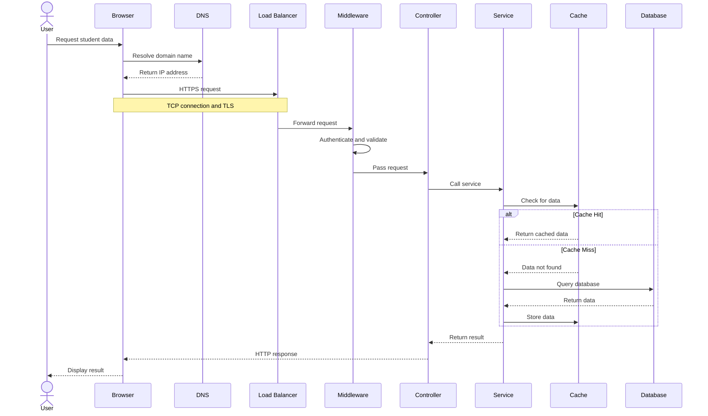

# Fundamental Module 3: Client-Server Request Flow (End to End)

## 1. Introduction

Client-server request flow is the process of how a client sends a request to a server, how the server processes it, and how the response is sent back to the client. This happens whenever we use a website, application or any online service.

For example, when we log in to a website or search for something, our browser sends a request to the server. The server processes the request, retrieves the necessary data and sends the result back to us.

## 2. Understanding the Complete Request Flow

The request flow involves several components that work together to make communication between the client and server possible.

**The main request flow:**

Client → DNS → TCP/TLS → Load Balancer → Middleware → Controller → Service → Cache → Database → Response → Client

### Step 1: Client

The client is the device or application used by the user, such as a web browser, mobile application or desktop application.

When a user performs an action, such as clicking a button, logging in or requesting information, the client sends a request to the server.

**Example:** When we open a website, our browser sends a request to the server to load the webpage.

### Step 2: DNS (Domain Name System)

DNS helps the browser find the server by translating a domain name into an IP address. Since computers communicate using IP addresses, DNS makes it easier for us to access websites using names instead of remembering IP addresses.

**Example:** When we enter `google.com`, DNS helps find the IP address associated with that domain.

### Step 3: TCP and TLS

Before data is exchanged, the client and server need to establish a connection.

- **TCP (Transmission Control Protocol):** TCP establishes a reliable connection between the client and server. It helps ensure that data is delivered correctly and in the proper order.
- **TLS (Transport Layer Security):** TLS encrypts the communication between the client and server to protect sensitive information from being easily accessed by others.

TCP usually establishes a connection using a three-way handshake:

1. SYN – The client requests a connection.
2. SYN-ACK – The server responds and agrees to the connection.
3. ACK – The client confirms the connection.

HTTPS uses TLS to protect communication over the internet.

### Step 4: Load Balancer

A load balancer distributes incoming requests across multiple servers so that one server does not have to handle all the traffic alone.

It helps improve performance, availability and reliability. If one server becomes unavailable, the load balancer may redirect requests to another healthy server.

### Step 5: Middleware

Middleware is a piece of software that runs between the incoming request and the main application logic. It checks and processes requests before they reach the controller.

Middleware can be used for:

- Authentication and authorization.
- Checking and validating incoming data.
- Logging requests.
- Handling errors.
- Limiting the number of requests.

**Example:** When a user tries to access a protected page, middleware can check whether the user has a valid JWT token before allowing access.

### Step 6: Controller

The controller receives the request after it passes through the middleware. It handles the request and decides which service should be called to perform the required operation.

The controller is also responsible for preparing and sending the response back to the client.

**Example:** When a user submits a login form, the login controller receives the login details and calls the authentication service to verify them.

### Step 7: Service

The service layer contains the main business logic of the application. It handles the actual operations and rules required to process a request.

The service may communicate with the cache or database to retrieve, update or manage data.

**Example:** In a login system, the authentication service checks whether the user's credentials are correct and determines whether the user should be allowed to log in.

### Step 8: Cache

A cache is a temporary storage that keeps frequently accessed data so that it can be retrieved faster without always querying the database.

There are two common situations when accessing a cache:

- **Cache Hit:** The requested data is already available in the cache, so it can be returned quickly.
- **Cache Miss:** The requested data is not available in the cache, so the application needs to retrieve it from another source, usually the database.

#### Cache Hit

1. The service requests data from the cache.
2. The cache contains the requested data.
3. The cache returns the data to the service.
4. The service sends the result back through the controller.

#### Cache Miss

1. The service requests data from the cache.
2. The cache does not contain the requested data.
3. The service retrieves the data from the database.
4. The database returns the data to the service.
5. The service may store the data in the cache for future requests.
6. The service sends the result back through the controller.

### Step 9: Database

The database is where application data is stored and managed. When the requested data is not available in the cache, the server can retrieve it from the database.

The database can also be used to insert, update or delete information depending on the request.

Some examples of databases are MySQL, PostgreSQL and MongoDB.

**Example:** When a student logs in, the application may retrieve the student's account information from the database to verify the login.

### Step 10: Response

After the request has been processed, the result is returned to the client.

The response usually travels back through the service and controller, where an HTTP response is sent to the browser. The browser then displays the result to the user.

Some common HTTP status codes are:

| Status Code | Meaning |
|---|---|
| 200 | OK – The request was successful. |
| 201 | Created – A new resource was created successfully. |
| 400 | Bad Request – The request contains invalid data. |
| 401 | Unauthorized – Authentication is required or failed. |
| 403 | Forbidden – The user is not allowed to access the resource. |
| 404 | Not Found – The requested resource could not be found. |
| 500 | Internal Server Error – Something went wrong on the server. |

## 3. Sequence Diagram

The sequence diagram below shows how a request travels from the client to the server and how the different components interact. It also shows both cache hit and cache miss situations.

## 4. Where Delays and Failures Can Happen

During the request flow, different components may experience delays or failures.

| Component | Possible Delay or Failure |
|---|---|
| DNS | DNS lookup failure or slow resolution. |
| TCP | Connection timeout or connection failure. |
| TLS | Certificate problems or handshake failure. |
| Load Balancer | Overloaded server or unhealthy server. |
| Middleware | Authentication failure or invalid request. |
| Controller | Incorrect handling of a request. |
| Service | Business logic errors. |
| Cache | Cache unavailable or cache miss. |
| Database | Slow queries, connection problems or database failure. |
| Network | Latency, packet loss or connection problems. |

Understanding these possible problems helps developers identify where an application is slowing down or failing.

## 5. Important Terms

| Term | Meaning |
|---|---|
| Client | The application that sends a request. |
| Server | The system that receives and processes requests. |
| DNS | Translates domain names into IP addresses. |
| TCP | Provides reliable communication between systems. |
| TLS | Encrypts communication between the client and server. |
| HTTP | Protocol used for communication between web clients and servers. |
| Load Balancer | Distributes incoming requests across servers. |
| Middleware | Processes and checks requests before they reach the main application logic. |
| Controller | Handles incoming requests and sends responses. |
| Service | Contains the business logic of an application. |
| Cache | Temporarily stores frequently accessed data for faster retrieval. |
| Database | Stores and manages application data. |
| API | Allows different software applications to communicate with each other. |

## 6. Conclusion

By tracing a request from the client through DNS, TCP/TLS, the load balancer, middleware, controller, service, cache and database, I was able to understand how different components work together to process a request. I also learned how cache hits and cache misses affect data retrieval and performance. Understanding this flow makes it easier to identify where delays, errors and failures can happen in a web application.

